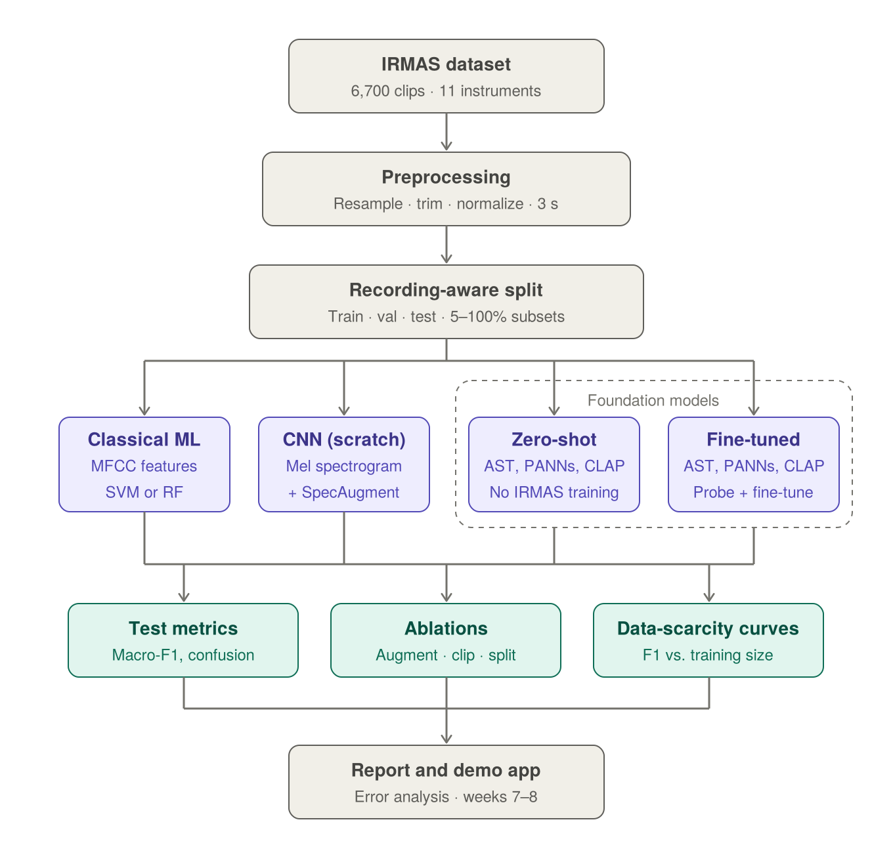

# Neural Band: Musical Instrument Recognition

**CNN vs. classical machine learning vs. audio foundation models on IRMAS**

Team: Aisha Abouganba (aa2381) · Bhagyashri Farkade (bbf24) · Srija Dwarakacherla (sd2003)

## Research questions

1. **RQ1.** Does a CNN on mel spectrograms beat a classical model (SVM / Random Forest on MFCC features) by at least 5 macro-F1 points?
2. **RQ2.** How do pretrained audio foundation models (AST, PANNs, CLAP) compare with our CNN, both **zero-shot** and **fine-tuned**, especially when training data is scarce?

The full proposal is in [`report/Project_Proposal_Neural_Band_Revised.pdf`](report/Project_Proposal_Neural_Band_Revised.pdf).

## Architecture



## Repository structure

| Folder | What goes there | Owner |
|---|---|---|
| `scripts/` | Data download and one-off scripts | Aisha |
| `src/preprocessing/` | Resample, trim silence, normalize, 3 s clips | Aisha |
| `src/splits/` | Recording-aware train/val/test split, 5–100% subsets | Aisha |
| `src/classical/` | MFCC features + SVM / Random Forest | Aisha |
| `src/cnn/` | CNN on mel spectrograms + SpecAugment | Bhagyashri |
| `src/foundation/zero_shot/` | AST, PANNs, CLAP without IRMAS training | Srija |
| `src/foundation/finetune/` | Linear probe and fine-tuning | Bhagyashri |
| `src/evaluation/` | Macro-F1, confusion matrix, ablations, data-scarcity curves | Srija |
| `notebooks/` | Exploration and Colab runs | Everyone |
| `results/` | Metric tables and plots (small files only) | Everyone |
| `demo/` | Demo app (week 7) | Everyone |
| `report/` | Proposal, final report, slides | Everyone |

`data/` is created locally by the download script and is **not** pushed to GitHub.

## Setup

```bash
git clone https://github.com/YOUR-USERNAME/neural-band-instrument-recognition.git
cd neural-band-instrument-recognition
python -m venv .venv
source .venv/bin/activate        # Windows: .venv\Scripts\activate
pip install -r requirements.txt
python scripts/download_irmas.py # downloads IRMAS training data into data/
python -m src.splits.make_splits # builds results/splits/*.csv (committed, so skip if already present)
python preprocess_irmas.py       # builds irmas_prep/ (local only, not committed — see below)
```

On Google Colab: clone the repo in a cell, run `pip install -r requirements.txt`, and keep `data/` on Google Drive so you don't re-download it every session.

## Data splits and preprocessing

Everyone trains and evaluates on the **same** split files and the **same** cleaned features, so results are comparable across the CNN, foundation models, and the classical baseline.

### 1. Recording-aware train/val/test split (`src/splits/make_splits.py`)

IRMAS cuts several 3 s clips out of each source recording. If clips from the same recording end up in both train and test, a model can "cheat" by recognizing the recording instead of the instrument — so every clip from one recording must stay in a single split.

- **Recording ID**: the filename up to the final `__N` (e.g. `[cel][cla]0001__1.wav` → `[cel][cla]0001`). IRMAS actually ships two filename shapes — `[inst][genre]NNNN__N.wav` and `NNN__[inst][drums][genre]NNNN__N.wav` (with an extra leading counter) — but that leading counter is unique within each instrument folder, so this rule still groups every clip correctly; we verified this against all 6705 files in the real dataset.
- **Split**: `GroupShuffleSplit` on those recording groups, stratified by nothing but kept class-complete — 70% train / 15% val / 15% test by recording.
- **Data-scarcity subsets**: for the "how much data do we actually need?" experiments, `train.csv` is cut down to class-balanced 5% / 10% / 25% / 50% / 100% subsets, chosen by whole recordings so each smaller subset is **nested inside** every larger one (5% ⊂ 10% ⊂ 25% ⊂ 50% ⊂ 100%).
- **Seed**: fixed at `SPLIT_SEED = 42` in `src/config.py`. Don't change it — re-running the script with seed 42 reproduces byte-identical CSVs for everyone.

Run once (outputs are already committed, so you normally don't need to):

```bash
python -m src.splits.make_splits
```

Writes to `results/splits/`:

| File | Rows | Columns |
|---|---|---|
| `train.csv` | 4702 | `path, label, group` |
| `val.csv` | 1004 | `path, label, group` |
| `test.csv` | 999 | `path, label, group` |
| `train_005pct.csv` … `train_100pct.csv` | 236 … 4702 | `path, label, group` |

Verified: no recording appears in more than one split; all 11 instruments appear in train, val, and test; subsets are properly nested.

### 2. Feature extraction (`preprocess_irmas.py`)

Reads the split CSVs above (so the manifest can never disagree with them), cleans every clip the same way regardless of which model will use it — resample to 22.05 kHz, trim silence, peak-normalize, pad/crop to exactly 3 s (`src/preprocessing/audio.py`) — and extracts:

- **log-mel spectrograms**, for the CNN and as a base for the foundation models
- **pooled MFCCs** (mean + std of 20 coefficients over time → 40-d vector), for the classical SVM / Random Forest baseline

```bash
python preprocess_irmas.py --out-dir irmas_prep
```

Writes to `irmas_prep/` (not committed — regenerate locally or on Colab after pulling `results/splits/`):

| File | Shape | Used by |
|---|---|---|
| `manifest.csv` | (6705, 9) — `path, label, recording_id, split, pct_005…pct_100` | everyone, to look up which split/subset a feature row belongs to |
| `mels.npy` | (6705, 128, 130) float32 | CNN, foundation-model baselines |
| `mfcc_feats.npy` | (6705, 40) float32 | classical SVM / Random Forest |

`manifest.csv` and both `.npy` arrays are row-aligned — row *i* in `manifest.csv` is row *i* in `mels.npy` and `mfcc_feats.npy`. Verified on the full dataset: no NaN/Inf, no silent clips, row counts and order match exactly.

## Team workflow

1. Before starting work: `git checkout main` then `git pull`.
2. Make a branch for your task: `git checkout -b cnn-baseline`.
3. Commit small, clear steps: `git commit -m "Add mel spectrogram dataset class"`.
4. Push: `git push -u origin cnn-baseline`, then open a **Pull Request** on GitHub.
5. One teammate reviews, then merge into `main`.

Rules:
- Never push audio files, model weights (`*.pt`, `*.pth`, `*.ckpt`) or large outputs. GitHub rejects files over 100 MB.
- Use the **same split files and preprocessed features** for every model — see [Data splits and preprocessing](#data-splits-and-preprocessing). Don't regenerate `results/splits/` with a different seed.
- Touch the test set only once, at the end (week 7).
- Track tasks on the GitHub **Projects** board (one card per week, assigned to its owner).

## Timeline

| Week | Work |
|---|---|
| 1 | Setup, download data, read papers, explore data |
| 2 | Clean audio, extract features, split data |
| 3 | Train simple models; run zero-shot foundation models |
| 4 | Train CNN; extract pretrained embeddings |
| 5 | Fine-tune foundation models; linear probes |
| 6 | Ablations and data-scarcity experiments |
| 7 | Final testing, error analysis, demo app |
| 8 | Write report and presentation |

## References

1. Eronen & Klapuri (2000). Musical instrument recognition using cepstral coefficients and temporal features. ICASSP.
2. Bosch et al. (2012). A comparison of sound segregation techniques for predominant instrument recognition in musical audio signals. ISMIR.
3. Han, Kim & Lee (2017). Deep convolutional neural networks for predominant instrument recognition in polyphonic music. IEEE/ACM TASLP.
4. Park et al. (2019). SpecAugment. Interspeech.
5. Gemmeke et al. (2017). Audio Set. ICASSP.
6. Kong et al. (2020). PANNs: Large-scale pretrained audio neural networks. IEEE/ACM TASLP.
7. Gong, Chung & Glass (2021). AST: Audio Spectrogram Transformer. Interspeech.
8. Elizalde et al. (2023). CLAP: Learning audio concepts from natural language supervision. ICASSP.
