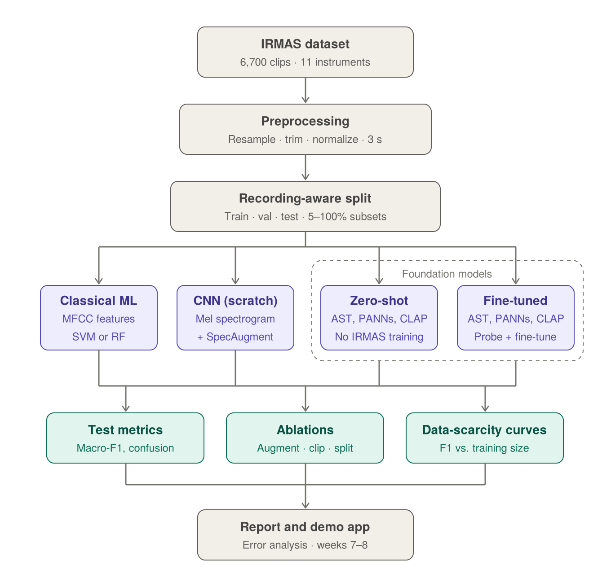

# Neural Band: Musical Instrument Recognition

**CNN vs. classical machine learning vs. audio foundation models on IRMAS**

Team: Aisha Abouganba (aa2381) · Bhagyashri Farkade (bbf24) · Srija Dwarakacherla (sd2003)

## Research questions

1. **RQ1.** Does a CNN on mel spectrograms beat a classical model (SVM / Random Forest on MFCC features) by at least 5 macro-F1 points?
2. **RQ2.** How do pretrained audio foundation models (AST, PANNs, CLAP) compare with our CNN, both **zero-shot** and **fine-tuned**, especially when training data is scarce?

The full proposal is in [`report/Project_Proposal_Neural_Band_Revised.pdf`](report/Project_Proposal_Neural_Band_Revised.pdf).

## Architecture



## Repository structure

| Folder | What goes there | Owner |
|---|---|---|
| `scripts/` | Data download and one-off scripts | Aisha |
| `src/preprocessing/` | Resample, trim silence, normalize, 3 s clips | Aisha |
| `src/splits/` | Recording-aware train/val/test split, 5–100% subsets | Aisha |
| `src/classical/` | MFCC / stronger classical features + SVM / Random Forest (currently `baseline_mfcc.py` at repo root, reads `irmas_prep/`) | Aisha |
| `baseline_results/` | Classical baseline metrics, reports, confusion matrices | Aisha |
| `src/cnn/` | CNN on mel spectrograms + SpecAugment | Bhagyashri |
| `src/foundation/zero_shot/` | AST, PANNs, CLAP without IRMAS training | Srija |
| `src/foundation/finetune/` | Linear probe and fine-tuning | Bhagyashri |
| `src/evaluation/` | Macro-F1, confusion matrix, ablations, data-scarcity curves | Srija |
| `notebooks/` | Exploration and Colab runs | Everyone |
| `results/` | Metric tables and plots (small files only) | Everyone |
| `demo/` | Demo app (week 7) | Everyone |
| `report/` | Proposal, final report, slides | Everyone |

`data/` is created locally by the download script and is **not** pushed to GitHub.

## Setup

```bash
git clone https://github.com/YOUR-USERNAME/neural-band-instrument-recognition.git
cd neural-band-instrument-recognition
python -m venv .venv
source .venv/bin/activate        # Windows: .venv\Scripts\activate
pip install -r requirements.txt
python scripts/download_irmas.py # downloads IRMAS training data into data/
python -m src.splits.make_splits # builds results/splits/*.csv (committed, so skip if already present)
python preprocess_irmas.py       # builds irmas_prep/ (local only, not committed — see below)
```

On Google Colab: clone the repo in a cell, run `pip install -r requirements.txt`, and keep `data/` on Google Drive so you don't re-download it every session.

## Data splits and preprocessing

Everyone trains and evaluates on the **same** split files and the **same** cleaned features, so results are comparable across the CNN, foundation models, and the classical baseline.

### 1. Recording-aware train/val/test split (`src/splits/make_splits.py`)

IRMAS cuts several 3 s clips out of each source recording. If clips from the same recording end up in both train and test, a model can "cheat" by recognizing the recording instead of the instrument — so every clip from one recording must stay in a single split.

- **Recording ID**: the filename up to the final `__N` (e.g. `[cel][cla]0001__1.wav` → `[cel][cla]0001`). IRMAS actually ships two filename shapes — `[inst][genre]NNNN__N.wav` and `NNN__[inst][drums][genre]NNNN__N.wav` (with an extra leading counter) — but that leading counter is unique within each instrument folder, so this rule still groups every clip correctly; we verified this against all 6705 files in the real dataset.
- **Split**: `GroupShuffleSplit` on those recording groups, stratified by nothing but kept class-complete — 70% train / 15% val / 15% test by recording.
- **Data-scarcity subsets**: for the "how much data do we actually need?" experiments, `train.csv` is cut down to class-balanced 5% / 10% / 25% / 50% / 100% subsets, chosen by whole recordings so each smaller subset is **nested inside** every larger one (5% ⊂ 10% ⊂ 25% ⊂ 50% ⊂ 100%).
- **Seed**: fixed at `SPLIT_SEED = 42` in `src/config.py`. Don't change it — re-running the script with seed 42 reproduces byte-identical CSVs for everyone.

Run once (outputs are already committed, so you normally don't need to):

```bash
python -m src.splits.make_splits
```

Writes to `results/splits/`:

| File | Rows | Columns |
|---|---|---|
| `train.csv` | 4702 | `path, label, group` |
| `val.csv` | 1004 | `path, label, group` |
| `test.csv` | 999 | `path, label, group` |
| `train_005pct.csv` … `train_100pct.csv` | 236 … 4702 | `path, label, group` |

Verified: no recording appears in more than one split; all 11 instruments appear in train, val, and test; subsets are properly nested.

**Random split (split ablation only).** The same script also writes a *leaky* clip-level split to `results/splits/random/{train,val,test}.csv` (4693 / 1006 / 1006 clips, stratified by instrument, seed 42) that ignores recordings. 917 of its 1006 test clips (91%) share a recording with train. It exists only for the proposal's "random split vs. careful split" ablation — **never use it for headline results**. Regenerating it does not change the recording-aware CSVs above.

### 2. Feature extraction (`preprocess_irmas.py`)

Reads the split CSVs above (so the manifest can never disagree with them), cleans every clip the same way regardless of which model will use it — resample to 22.05 kHz, trim silence, peak-normalize, pad/crop to exactly 3 s (`src/preprocessing/audio.py`) — and extracts:

- **log-mel spectrograms**, for the CNN and as a base for the foundation models
- **pooled MFCCs** (mean + std of 20 coefficients over time → 40-d vector), for the classical SVM / Random Forest baseline
- **stronger classical features** (mean + std over time of 20 MFCCs, their deltas and delta-deltas, spectral centroid / bandwidth / rolloff / flatness, 7-band spectral contrast, zero-crossing rate, RMS energy and 12 chroma bins → 170-d vector), for the stronger classical baseline

```bash
python preprocess_irmas.py --out-dir irmas_prep
```

Writes to `irmas_prep/` (not committed — regenerate locally or on Colab after pulling `results/splits/`):

| File | Shape | Used by |
|---|---|---|
| `manifest.csv` | (6705, 10) — `path, label, recording_id, split, pct_005…pct_100, split_random` | everyone, to look up which split/subset a feature row belongs to (`split_random` is for the split ablation only) |
| `mels.npy` | (6705, 128, 130) float32 | CNN, foundation-model baselines |
| `mfcc_feats.npy` | (6705, 40) float32 | classical SVM / Random Forest |
| `classical_feats.npy` | (6705, 170) float32 | stronger classical SVM / Random Forest |
| `classical_feats.txt` | 170 lines | column names for `classical_feats.npy` |

`manifest.csv` and all `.npy` arrays are row-aligned — row *i* in `manifest.csv` is row *i* in every array. Verified on the full dataset: no NaN/Inf, no silent clips, row counts and order match exactly.

> **Pulled after the stronger features / random split were added?** `irmas_prep/` isn't committed, so re-run `python preprocess_irmas.py --out-dir irmas_prep` once to get `classical_feats.npy` and the `split_random` column. `mels.npy` and `mfcc_feats.npy` come out byte-identical to before, so existing CNN / foundation-model results are unaffected.

## Classical baseline: MFCC + SVM / Random Forest (`baseline_mfcc.py`)

The RQ1 reference point the CNN has to beat. For every training subset (5 / 10 / 25 / 50 / 100%) it trains SVM and Random Forest candidates and picks hyperparameters by **macro-F1 on the val split**. Test is only scored when `--eval_test` is passed — save that for the final evaluation in week 7.

- **Features** (`--features`): `mfcc` (default) uses the shared `irmas_prep/mfcc_feats.npy` (40-d pooled MFCCs); `classical` uses `irmas_prep/classical_feats.npy` (170-d stronger features). Train/val/subset membership is read from `irmas_prep/manifest.csv` — the same cleaned clips and splits every other model uses.
- **Split** (`--split`): `recording` (default) is the recording-aware split; `random` uses the leaky `split_random` column for the split ablation and runs on 100% of its train split only (the scarcity subsets are defined on the recording-aware split).
- **SVM**: `StandardScaler` → RBF `SVC`, `class_weight="balanced"`; grid `C ∈ {1, 10, 100}`, `gamma ∈ {scale, 0.01, 0.001}`.
- **Random Forest**: 500 trees, `class_weight="balanced"`; grid `max_features ∈ {sqrt, 0.3}`, `min_samples_leaf ∈ {1, 2}`.
- **Seed**: 42.

```bash
python baseline_mfcc.py --prep_dir irmas_prep               # val only (default)
python baseline_mfcc.py --prep_dir irmas_prep --eval_test   # week 7: also score test

# stronger classical features
python baseline_mfcc.py --features classical --out_dir baseline_results/classical

# split ablation (random vs. recording-aware split), 100% train only
python baseline_mfcc.py --features mfcc      --split random --out_dir baseline_results/mfcc_random_split
python baseline_mfcc.py --features classical --split random --out_dir baseline_results/classical_random_split
```

Writes to `--out_dir` (default `baseline_results/`):

| File | Contents |
|---|---|
| `results.csv` | model, features, split, subset %, n_train, best params, val macro-F1 (+ test macro-F1 with `--eval_test`) |
| `report_svm.txt`, `report_rf.txt` | per-class precision / recall / F1 on val (on test with `--eval_test`), 100% subset |
| `confusion_svm.png`, `confusion_rf.png` | row-normalized confusion matrices for the same split, 100% subset |

### Results (val macro-F1)

| Train subset | n_train | SVM | Random Forest |
|---|---|---|---|
| 5% | 236 | 0.297 | 0.297 |
| 10% | 474 | 0.324 | 0.326 |
| 25% | 1174 | 0.394 | 0.380 |
| 50% | 2358 | 0.441 | 0.404 |
| 100% | 4702 | **0.494** | 0.444 |

Takeaways:
- **SVM is the stronger baseline** once there is enough data. The two models are tied at 5–10%, but on full data SVM reaches 0.494 macro-F1 (50.2% accuracy) vs. 0.444 (46.1%) for RF. For RQ1, the CNN needs **≥ 0.544 val macro-F1** to clear the 5-point bar.
- Performance is still climbing at 100% (+5.3 points from 50% → 100% for SVM), so the classical models are data-limited rather than saturated.
- Easiest classes (SVM, full data): voice (F1 0.71), piano (0.57), acoustic guitar (0.56). Hardest: clarinet (0.38), saxophone (0.40) and flute (0.42). See `confusion_svm.png`.

### Stronger classical features (val macro-F1, `baseline_results/classical/`)

| Train subset | n_train | SVM (MFCC, 40-d) | SVM (classical, 170-d) | RF (MFCC) | RF (classical) |
|---|---|---|---|---|---|
| 5% | 236 | 0.297 | 0.281 | 0.297 | 0.289 |
| 10% | 474 | 0.324 | 0.331 | 0.326 | 0.325 |
| 25% | 1174 | 0.394 | 0.431 | 0.380 | 0.384 |
| 50% | 2358 | 0.441 | 0.495 | 0.404 | 0.409 |
| 100% | 4702 | 0.494 | **0.545** | 0.444 | 0.463 |

Takeaways:
- The richer features add **~5 points** to the SVM from 25% data upward (0.494 → 0.545 at 100%, 55.2% accuracy); RF barely moves. At 5% they slightly hurt — 170 features is a lot for 236 clips.
- This is the tougher RQ1 reference: the CNN needs **≥ 0.595 val macro-F1** to clear the 5-point bar against it.
- Per class (SVM, full data): voice (0.74), acoustic guitar (0.69) and violin (0.61) are easiest; saxophone (0.38), flute (0.38) and clarinet (0.47) are still hardest.

### Split ablation: random vs. recording-aware split (val macro-F1, 100% train)

| Features | Model | Recording-aware | Random (leaky) | Inflation |
|---|---|---|---|---|
| MFCC (40-d) | SVM | 0.494 | 0.596 | +10.2 |
| MFCC (40-d) | RF | 0.444 | 0.539 | +9.5 |
| Classical (170-d) | SVM | 0.545 | 0.659 | +11.4 |
| Classical (170-d) | RF | 0.463 | 0.580 | +11.7 |

Splitting clips at random lets a model score on recordings it has already heard, inflating macro-F1 by **~10–12 points**. Each split is scored on its own val set, so this compares protocols rather than identical clips. Other models can run the same ablation by training on `manifest.split_random == "train"` and scoring on `== "val"`.

## Team workflow

1. Before starting work: `git checkout main` then `git pull`.
2. Make a branch for your task: `git checkout -b cnn-baseline`.
3. Commit small, clear steps: `git commit -m "Add mel spectrogram dataset class"`.
4. Push: `git push -u origin cnn-baseline`, then open a **Pull Request** on GitHub.
5. One teammate reviews, then merge into `main`.

Rules:
- Never push audio files, model weights (`*.pt`, `*.pth`, `*.ckpt`) or large outputs. GitHub rejects files over 100 MB.
- Use the **same split files and preprocessed features** for every model — see [Data splits and preprocessing](#data-splits-and-preprocessing). Don't regenerate `results/splits/` with a different seed.
- Touch the test set only once, at the end (week 7).
- Track tasks on the GitHub **Projects** board (one card per week, assigned to its owner).

## Timeline

| Week | Work |
|---|---|
| 1 | Setup, download data, read papers, explore data |
| 2 | Clean audio, extract features, split data |
| 3 | Train simple models; run zero-shot foundation models |
| 4 | Train CNN; extract pretrained embeddings |
| 5 | Fine-tune foundation models; linear probes |
| 6 | Ablations and data-scarcity experiments |
| 7 | Final testing, error analysis, demo app |
| 8 | Write report and presentation |

## References

1. Eronen & Klapuri (2000). Musical instrument recognition using cepstral coefficients and temporal features. ICASSP.
2. Bosch et al. (2012). A comparison of sound segregation techniques for predominant instrument recognition in musical audio signals. ISMIR.
3. Han, Kim & Lee (2017). Deep convolutional neural networks for predominant instrument recognition in polyphonic music. IEEE/ACM TASLP.
4. Park et al. (2019). SpecAugment. Interspeech.
5. Gemmeke et al. (2017). Audio Set. ICASSP.
6. Kong et al. (2020). PANNs: Large-scale pretrained audio neural networks. IEEE/ACM TASLP.
7. Gong, Chung & Glass (2021). AST: Audio Spectrogram Transformer. Interspeech.
8. Elizalde et al. (2023). CLAP: Learning audio concepts from natural language supervision. ICASSP.
